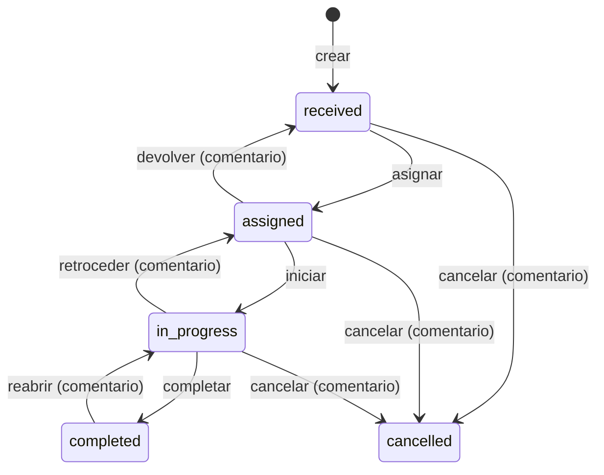

# Solvia

Aplicación de escritorio para la **gestión inteligente de solicitudes**. Cada solicitud
recorre los estados _recibida → asignada → en proceso → completada_, y una IA (DeepSeek)
detecta retrasos y cuellos de botella.

> **Estado actual:** autenticación, roles y administración; solicitudes de punta a punta (flujo
> de estados, asignación, comentarios, historial, lista, tablero kanban y detalle); y SLA,
> alertas automáticas, detección de cuellos de botella y panel de control. El análisis con IA
> (DeepSeek) llega a continuación y ya tiene su espacio reservado en el panel.

## Stack

| Parte | Tecnologías |
| --- | --- |
| `backend/` | Python 3.12 · FastAPI · SQLAlchemy 2 (async, asyncpg) · Alembic · Pydantic 2 · structlog · PyJWT · argon2 (pwdlib) · APScheduler |
| `desktop/` | Tauri 2 · React 19 · TypeScript · Vite · Tailwind CSS 4 · i18next · TanStack Query · Zustand · React Router · React Hook Form · Zod · dnd-kit · Recharts |
| Infra | PostgreSQL 16 (Docker) · GitHub Actions · gitleaks |

## Requisitos

- [Docker Desktop](https://www.docker.com/products/docker-desktop/)
- [uv](https://docs.astral.sh/uv/) (`brew install uv`): instala Python 3.12 automáticamente
- Node.js 22 o superior (la versión de referencia está en `desktop/.nvmrc`)
- Rust, solo para ejecutar o empaquetar la app de escritorio: `brew install rustup && rustup default stable`
- En Linux, además, las [dependencias de Tauri](https://v2.tauri.app/start/prerequisites/) y `libdbus-1-dev`

> **macOS con Homebrew:** `rustup` no se enlaza en el `PATH`. Añade esta línea a tu `~/.zshrc`:
> `export PATH="/opt/homebrew/opt/rustup/bin:$PATH"`

## 1. Configuración inicial

```bash
cp .env.example .env
```

`.env` está en `.gitignore`: **nunca se versiona**. Ajusta allí los valores locales y, como
mínimo, define el administrador inicial:

```dotenv
SEED_ADMIN_EMAIL=admin@example.com
SEED_ADMIN_PASSWORD=<mínimo 12 caracteres>
# Usuarios de demostración (supervisor, responsables y solicitantes); necesaria para --demo
SEED_DEMO_PASSWORD=<mínimo 12 caracteres>
```

Si tu `.env` viene de una versión anterior, copia también las variables nuevas de
`.env.example` (`REFRESH_TOKEN_DAYS`, `LOGIN_RATE_LIMIT_*`, `SEED_*`, `ORGANIZATION_TIMEZONE`,
`ALERTS_JOB_*`) y cambia `JWT_SECRET`: un secreto de menos de 32 caracteres hace que PyJWT
muestre avisos.

| Variable | Por defecto | Uso |
| --- | --- | --- |
| `ORGANIZATION_TIMEZONE` | `America/Bogota` | Zona IANA con la que se agrupan los días del panel y se leen los filtros por fecha; la base de datos guarda siempre UTC |
| `ALERTS_JOB_ENABLED` | `true` | Activa el job de alertas dentro de la API |
| `ALERTS_JOB_INTERVAL_MINUTES` | `15` | Cada cuánto evalúa el job |

### Activar DeepSeek (opcional)

En `.env`:

```dotenv
AI_PROVIDER=deepseek
DEEPSEEK_API_KEY=<tu clave>
```

Con `AI_PROVIDER=none` (valor por defecto) se usa un puntaje heurístico sin llamadas externas.
Si eliges `deepseek` sin clave, la API no arranca y muestra un error explícito.

## 2. Levantar el backend

### Opción A: todo en Docker

```bash
docker compose up -d --build                                # aplica las migraciones al arrancar
docker compose exec api python -m app.scripts.seed --demo   # admin, áreas, SLA y datos de demo
```

Sin `--demo` la semilla crea solo el admin, las áreas y la matriz SLA.

- Estado: <http://localhost:8000/api/v1/health>
- Documentación interactiva: <http://localhost:8000/docs> (desactivada en producción)

Para ver los logs: `docker compose logs -f api`. Para pararlo: `docker compose down`
(añade `-v` para borrar también los datos de PostgreSQL).

### Opción B: API local con recarga automática

```bash
docker compose up -d postgres          # solo la base de datos
cd backend
uv sync                                # crea .venv con Python 3.12
uv run alembic upgrade head
uv run python -m app.scripts.seed --demo
uv run uvicorn app.main:create_app --factory --reload
```

La API y la semilla leen el `.env` de la raíz del repositorio. La semilla es idempotente:
puedes ejecutarla las veces que quieras y solo crea lo que falta, sin sobrescribir
contraseñas ni políticas SLA editadas.

### Datos de demostración (`--demo`)

Con `--demo` (y `SEED_DEMO_PASSWORD` definida; no se permite en producción) se crean estos
usuarios, todos con la contraseña de `SEED_DEMO_PASSWORD`:

| Email | Rol | Área |
| --- | --- | --- |
| `supervisor@example.com` | supervisor (responsable del área) | Soporte TI |
| `responsable1@example.com` | assignee | Soporte TI |
| `responsable2@example.com` | assignee | Recursos Humanos |
| `responsable3@example.com` | assignee | Finanzas |
| `solicitante1@example.com` · `solicitante2@example.com` | requester | — |

Además se generan 136 solicitudes repartidas entre áreas, prioridades y estados, con historial
realista (asignaciones, devoluciones, retrocesos, comentarios y cierres):

- 36 abiertas con una mezcla realista: alrededor del 15 % vencidas, el 10 % por vencer y el
  20 % sin movimiento.
- 100 cerradas, con cierres repartidos en los últimos 30 días y tiempo en cada etapa
  proporcional a su SLA, para que las tendencias y las medianas de 30 días de los cuellos de
  botella reflejen una carga estable.

La generación es determinista y no se repite si ya existen. Tras sembrar, el job crea las
alertas en su primera ronda (al arrancar la API) o puedes forzarla con
`POST /api/v1/alerts/evaluate` como admin.

### Probar el login con el admin semilla

```bash
curl -s -X POST http://localhost:8000/api/v1/auth/login \
  -H 'Content-Type: application/json' \
  -d '{"email": "<SEED_ADMIN_EMAIL>", "password": "<SEED_ADMIN_PASSWORD>"}'
```

La respuesta incluye `access_token` (30 min), `refresh_token` y el perfil del usuario.

## 3. Levantar la app de escritorio

```bash
cd desktop
npm install
npm run tauri dev      # ventana nativa (necesita Rust)
# o bien
npm run dev            # solo el frontend en http://localhost:1420
```

- Inicia sesión con el admin semilla. Con **Recordarme**, el refresh token se guarda en el
  llavero del sistema (Llavero de macOS, Administrador de credenciales de Windows o Secret
  Service en Linux) y la sesión se restaura al abrir la app. En `npm run dev` (navegador) no
  hay llavero y la sesión vive solo en memoria.
- Al iniciar sesión se aplican el tema y el idioma del perfil; los cambios en
  **Configuración** se guardan en el perfil.
- Los usuarios creados por un admin reciben una contraseña temporal y deben cambiarla al entrar.
- La URL de la API (por defecto `http://localhost:8000`) se cambia desde **Configuración**.

Para generar el instalador: `npm run tauri build`.

## Roles y permisos

**Administración**

| Rol | Puede |
| --- | --- |
| `admin` | Todo: áreas, usuarios y políticas SLA |
| `supervisor` | Ver los usuarios de su área |
| `assignee` · `requester` | Ver y editar su propio perfil |

Reglas adicionales: un admin no puede desactivarse a sí mismo, siempre queda al menos un admin
activo, y desactivar a un usuario cierra sus sesiones al instante.

**Solicitudes**

| Rol | Ve | Puede |
| --- | --- | --- |
| `requester` | Las que creó | Crear, comentar y editar título y descripción mientras está recibida |
| `assignee` | Las asignadas a él, las de su área y las que creó | Crear, comentar y avanzar o devolver las suyas |
| `supervisor` | Las de su área y las que creó | Todo lo anterior en su área, más asignar, reasignar, cancelar, reabrir y editar prioridad y fecha límite |
| `admin` | Todas | Todo; puede asignar fuera del área y queda registrado |

Las reglas viven en `services/request_policy.py` y se prueban aparte.

## Flujo de estados



- La tabla de transiciones está en un solo lugar: `services/request_workflow.py`. Cualquier
  otra transición devuelve `409 request.invalid_transition` con `{from, to}`.
- Cada cambio actualiza la solicitud, crea su evento (con valores anteriores y nuevos en
  `details`) y actualiza `last_activity_at` en una sola transacción.
- Concurrencia optimista: cada cambio envía la `version` conocida; si no coincide, la API
  responde `409 request.version_conflict` y la app recarga conservando lo escrito.
- `due_at` = recepción + suma de las horas máximas de las tres etapas para su prioridad; se
  recalcula si cambia la prioridad. Los indicadores de SLA se explican en la sección siguiente.

## SLA, alertas y cuellos de botella

Las reglas se expresan una sola vez, como expresiones SQL, en `repositories/sla_rules.py`. Las
usan la lista, el tablero, el detalle, los filtros, el panel y las alertas, así que todos
cuentan lo mismo. El tiempo transcurrido se calcula en una única función (`elapsed_hours`, en
horas calendario) para poder pasar a horario laboral más adelante.

| Tipo | Condición (solo solicitudes abiertas) | Severidad | Se resuelve cuando |
| --- | --- | --- | --- |
| `due_soon` | Consumido ≥ 75 % del tiempo entre la recepción y `due_at`, sin vencer | warning | Baja del 75 %, pasa a vencida o se cierra |
| `overdue` | `ahora ≥ due_at` | critical | `due_at` vuelve al futuro o se cierra |
| `stalled` | Inactividad mayor que el umbral de su prioridad y etapa | warning; critical si la prioridad es alta o crítica | Hay actividad o se cierra |
| `bottleneck` | Área × etapa con cantidad > 1,5 × su mediana de 30 días, o promedio de horas en la etapa mayor que el promedio de los máximos SLA de sus solicitudes | warning; critical si se cumplen las dos | La condición deja de cumplirse |

- **Una alerta abierta por objetivo:** índices únicos parciales por `(request_id, type)` y,
  para cuellos de botella, por `(area_id, etapa)` mientras `resolved_at` es nulo.
- **Sin textos en la base de datos:** cada alerta guarda `message_code` y `params`, y la app
  construye el texto con i18n.
- **Lectura por usuario:** la tabla `alert_reads` registra qué alertas leyó cada persona.
- **Job:** APScheduler dentro de la API evalúa cada 15 minutos y al arrancar. Un
  `pg_try_advisory_xact_lock` garantiza que, con varias réplicas, solo una procese cada ronda.
  Cada ronda deja el log estructurado `alerts_evaluated` con la duración y las alertas creadas,
  actualizadas y resueltas.
- **Reevaluación inmediata:** tras cada transición, asignación, edición o comentario se
  reevalúan las alertas de esa solicitud en un savepoint. Si falla, se registra en el log y el
  cambio se guarda igual; el job lo corrige en su siguiente ronda.
- **Cuellos de botella** (`services/bottlenecks.py`): el histórico se reconstruye desde
  `request_events`, con una foto al cierre de cada uno de los últimos 30 días en la zona horaria
  de la organización y medianas calculadas en SQL. El tiempo en la etapa cuenta desde que la
  solicitud entró en ella; una reasignación dentro de la misma etapa no lo reinicia.

### Panel y alertas en la app

- **Panel** (inicio):
  - Tarjetas de abiertas, próximas a vencer, vencidas, sin movimiento, completadas en 7 días y
    resolución promedio; cada una abre la lista con su filtro.
  - Barras por estado y líneas de creadas frente a completadas, con los colores del tema activo.
  - Mapa de calor área × etapa, con los cuellos de botella resaltados y el detalle al pasar el
    cursor.
  - Listas «En riesgo» y «Sin movimiento».
  - Bloque reservado para las recomendaciones de IA.
  - Filtro de área (admin) y de fechas, y refresco automático cada 60 s.
- **Campana** en el encabezado con las alertas abiertas sin leer, y página **Alertas** con
  filtros, marcar como leídas y enlace a la solicitud. En un cuello de botella, el enlace lleva
  a la lista filtrada por área y etapa.
- **Notificaciones del sistema** para alertas críticas nuevas: se activan en
  **Configuración › Notificaciones** (desactivadas por defecto) y solo funcionan en la app de
  escritorio.
- El estado del sistema (API, base de datos y proveedor de IA) está en **Configuración**.

## API (`/api/v1`)

| Recurso | Endpoints |
| --- | --- |
| Auth | `POST /auth/login` · `POST /auth/refresh` · `POST /auth/logout` · `GET /auth/me` · `PATCH /auth/me` |
| Áreas | `GET /areas` · `POST /areas` · `GET /areas/{id}` · `PATCH /areas/{id}` · `POST /areas/{id}/deactivate` · `POST /areas/{id}/activate` |
| Usuarios | `GET /users` · `POST /users` · `GET /users/{id}` · `PATCH /users/{id}` · `POST /users/{id}/deactivate` · `POST /users/{id}/activate` |
| SLA | `GET /sla-policies` · `PUT /sla-policies` |
| Solicitudes | `GET /requests` · `GET /requests/board` · `GET /requests/due-estimates` · `POST /requests` · `GET /requests/{id}` · `PATCH /requests/{id}` · `POST /requests/{id}/transition` · `POST /requests/{id}/assign` · `POST /requests/{id}/comments` · `GET /requests/{id}/events` |
| Panel | `GET /dashboard/summary` · `GET /dashboard/by-status` · `GET /dashboard/at-risk` · `GET /dashboard/stalled` · `GET /dashboard/bottlenecks` · `GET /dashboard/trends` · `GET /dashboard/by-area` |
| Alertas | `GET /alerts` · `GET /alerts/unread-count` · `PATCH /alerts/{id}/read` · `POST /alerts/read-all` · `POST /alerts/evaluate` (admin) |
| Estado | `GET /health` |

Las listas se paginan con `?page=1&size=20&q=texto` y responden `{items, total, page, size}`
(`size` máximo 100). `GET /requests` admite además `status` y `priority` repetibles,
`area_id`, `assignee_id`, `requester_id`, `overdue=true`, `sla_status`
(`on_track`, `at_risk` u `overdue`), `stalled=true`, `received_from`, `received_to`,
`completed_from`, `completed_to` (fechas en la zona de la organización) y `sort` (por ejemplo
`-due_at`), y siempre aplica el alcance del rol.

El panel acepta `area_id`, `date_from` y `date_to` (por defecto, los últimos 30 días). Las
métricas de estado actual ignoran el rango y aplican el mismo alcance por rol que la lista. La
matriz de cuellos de botella muestra todas las áreas al admin y solo la propia al supervisor y
al responsable; el solicitante no la ve. `GET /alerts` admite `type` y `severity` repetibles,
`is_read`, `state=open|resolved`, `area_id` y `q` (código o título de la solicitud).

**Sesiones:** el access token (JWT de 30 minutos con `sub`, `role` y `area_id`) vive solo en
memoria en el desktop. El refresh token es opaco, se guarda como hash SHA-256, rota en cada uso
y se revoca al cerrar sesión; si se reutiliza uno ya rotado, se revocan todas las sesiones del
usuario. El login admite 5 intentos fallidos por minuto por email+IP y nunca revela si el email
existe.

## Probar el flujo completo con distintos roles

Con la API levantada y la semilla ejecutada con `--demo`, abre la app (`npm run tauri dev`) y
usa, por ejemplo, dos ventanas o cierra sesión entre pasos:

1. **Solicitante** (`solicitante1@example.com`): en **Solicitudes**, pulsa **Nueva solicitud**,
   elige *Soporte TI* y prioridad *Alta*; antes de guardar verás la fecha límite estimada.
   Solo ves tus solicitudes; puedes editar título y descripción mientras esté recibida.
2. **Supervisor** (`supervisor@example.com`): en el tablero, arrastra la nueva tarjeta de
   *Recibida* a *Asignada*; se abrirá el diálogo para elegir responsable (solo de su área).
3. **Responsable** (`responsable1@example.com`): abre la solicitud, pulsa **Iniciar** y luego
   **Completar**. Prueba **Devolver** en otra asignada: exige un comentario y la deja sin
   responsable en la bandeja del supervisor.
4. **Supervisor**: abre la solicitud completada y pulsa **Reabrir** (pide comentario). El
   responsable no ve ese botón.
5. **Conflicto de versión**: abre la misma solicitud como supervisor en dos ventanas, cambia la
   prioridad en una y guarda el título en la otra: verás el aviso de que fue modificada por
   otra persona, la solicitud se recargará y tu título seguirá escrito.
6. **Admin** (`SEED_ADMIN_EMAIL`): ve todas las solicitudes y puede asignar a alguien de otra
   área; el historial lo marca como asignación fuera del área.

En la lista, prueba los filtros combinados (se guardan en la URL), el orden por columna y los
indicadores: rojo vencida, ámbar por vencer y reloj sin movimiento.

## Probar el panel y las alertas con la semilla demo

1. Siembra con `--demo` y arranca la API: el job crea las alertas en su primera ronda. Para
   repetirla al momento, llama a `POST /api/v1/alerts/evaluate` como admin.
2. **Admin**: el panel muestra 36 abiertas, de ellas 4 próximas a vencer, 5 vencidas y 7 sin
   movimiento. Pulsa cada tarjeta: la lista se abre con el filtro correspondiente y con el
   mismo total. En el mapa de calor, *Soporte TI · Recibida* aparece como cuello de botella
   crítico y algunas otras celdas como advertencia (varían un poco según la hora, porque las
   medianas usan una foto al cierre de cada día). Pasa el cursor para ver la cantidad, la
   mediana de 30 días y el máximo SLA, y pulsa la celda para ver esas solicitudes. Filtra por
   área o cambia el rango de fechas: todos los bloques se actualizan.
3. **Supervisor** (`supervisor@example.com`): ve solo Soporte TI en el panel y en la matriz, y
   la campana cuenta sus alertas sin leer. Al marcar una como leída, la del admin no cambia.
4. **Solicitante** (`solicitante1@example.com`): ve sus propias cifras, sin matriz de cuellos de
   botella.
5. **Resolución inmediata**: como responsable, completa una solicitud vencida desde su detalle;
   su alerta queda resuelta al instante, sin esperar al job, y la campana se actualiza.
6. **Notificaciones**: en la app de escritorio, activa **Configuración › Notificaciones** y
   acepta el permiso del sistema. Cuando aparezca una alerta crítica nueva (por ejemplo, al
   adelantar la fecha límite de una solicitud como supervisor), recibirás un aviso del sistema
   operativo.

## Pruebas y calidad

Las pruebas del backend usan un PostgreSQL real, separado del de desarrollo:

```bash
docker compose --profile test up -d postgres-test   # puerto 5433, datos en memoria

# Backend
cd backend
uv run ruff check . && uv run ruff format --check .
uv run mypy
uv run pytest            # aplica las migraciones reales y prueba auth, permisos, flujo…

# Desktop
cd desktop
npm run lint
npm run typecheck
npm test
npm run build
```

Si `postgres-test` no está levantado, las pruebas de base de datos se omiten (en CI fallan,
porque se define `REQUIRE_TEST_DB=1`). Para usar otra base, define `TEST_DATABASE_URL`. Las
pruebas de umbrales de SLA congelan el tiempo con `time-machine`.

### Rendimiento de las consultas del panel

```bash
cd backend
uv run python -m app.scripts.synthetic_load --requests 50000 --explain
```

El script solo acepta bases cuyo nombre termina en `_test` (por defecto, la de
`postgres-test`). Borra su contenido, genera solicitudes y eventos sintéticos de 180 días y
muestra el `EXPLAIN ANALYZE` de cada consulta del panel, de las alertas y de los filtros SLA.
Con 50 000 solicitudes y unos 197 000 eventos, todas usan índices y tardan menos de 15 ms,
salvo el histórico de cuellos de botella, que tarda unos 150 ms.

GitHub Actions (`.github/workflows/ci.yml`) ejecuta lo mismo en cada push o PR a `main`
(con un servicio PostgreSQL 16), compila el plugin nativo de Tauri con `clippy` y escanea el
historial con **gitleaks** en busca de secretos.

## Migraciones

```bash
cd backend
uv run alembic revision --autogenerate -m "crear tabla x"
uv run alembic upgrade head
uv run alembic check      # verifica que modelos y migraciones coinciden
```

Los modelos nuevos deben importarse en `app/models/__init__.py` para que Alembic los detecte.
Los enums de Postgres, la secuencia `request_code_seq` y la función `next_request_code()`
(códigos `SOL-0001`) se gestionan a mano en la migración `0001`. Nunca se edita una migración
ya aplicada: cada cambio de esquema va en una nueva:

- `0002`: añade `version`, `details` e índices para los filtros de solicitudes.
- `0003`: hace las alertas resolubles (`resolved_at`), les añade el área y la solicitud opcional
  con índices únicos parciales, y crea `alert_reads` en lugar de `alerts.is_read`.
- `0004`: añade un índice sobre `completed_at`.

## Estructura

```
backend/
  app/
    api/v1/        rutas HTTP: auth, areas, users, sla_policies, requests, dashboard, alerts, health
    core/          configuración, logging, errores, seguridad (JWT, argon2), rate limit
    db/            engine, sesión, Base (naming convention, mixins UUID/timestamps)
    models/        areas, users, requests, request_events, sla_policies, alerts,
                   ai_insights, refresh_tokens
    schemas/       modelos Pydantic de entrada/salida y paginación
    repositories/  acceso a datos (nunca hacen commit); sla_rules (reglas SLA en SQL),
                   dashboard y bottleneck (agregaciones)
    services/      reglas de negocio y transacciones; request_workflow (máquina de estados),
                   request_policy (permisos por rol), sla (fechas límite), alerts (evaluación
                   y lectura), bottlenecks (detección) y dashboard
    ai/            AIProvider + NullProvider + DeepSeekProvider + factory
    scripts/       seed (datos semilla), demo_data (136 solicitudes con historial) y
                   synthetic_load (datos sintéticos y planes de consulta)
    jobs/          job de alertas con APScheduler
  alembic/         migraciones (async)
  tests/           pruebas unitarias y tests/db contra PostgreSQL
desktop/
  src/
    components/    layout, guards de rutas, UI compartida, selectores
    pages/         login, panel, solicitudes (lista, tablero y detalle), alertas,
                   administración, configuración
    lib/           cliente de API con refresco automático, sesión, llavero, formato, colores
                   del tema, mensajes y notificaciones de alertas
    stores/        Zustand (sesión en memoria, tema, configuración)
    locales/       traducciones es/en por módulo
  src-tauri/       contenedor nativo (Rust) con el plugin secure-store y el de notificaciones
```

## Errores de la API

La API nunca devuelve textos: responde con códigos estables que el frontend traduce.

```json
{ "error": { "code": "auth.invalid_credentials", "params": {} } }
```

Las traducciones están en `desktop/src/locales/{es,en}/errors.json`. Una prueba del backend
falla si algún código no tiene traducción.

## Seguridad

- Los secretos (`JWT_SECRET`, `DEEPSEEK_API_KEY`, `DATABASE_URL`, `SEED_*_PASSWORD`) son
  `SecretStr` y se enmascaran en logs y errores.
- En producción la API no arranca si `JWT_SECRET` tiene el valor de ejemplo o menos de 32 caracteres.
- Contraseñas con argon2; refresh tokens guardados solo como hash.
- Los logs pasan por un filtro que oculta claves sensibles, tokens `Bearer`, claves `sk-…`
  y contraseñas en URLs.
- La imagen Docker se ejecuta con un usuario sin privilegios y los puertos solo escuchan en `127.0.0.1`.
