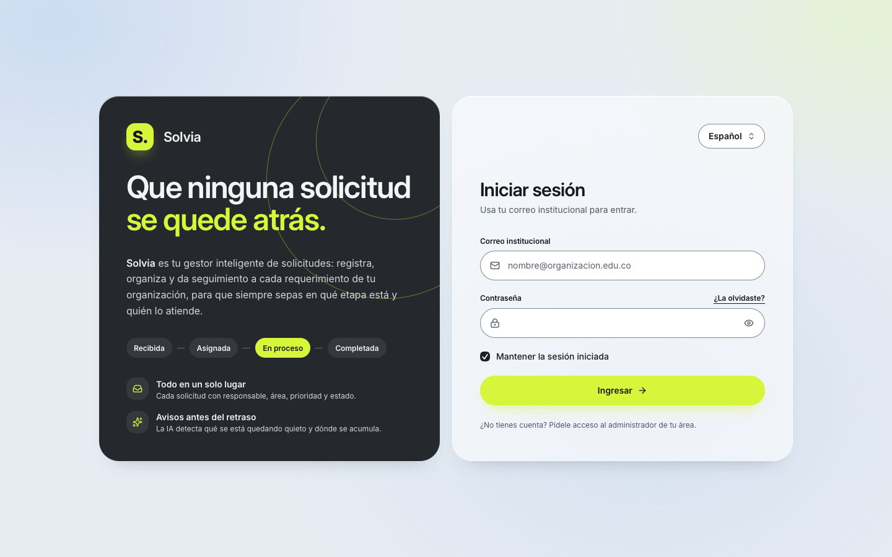
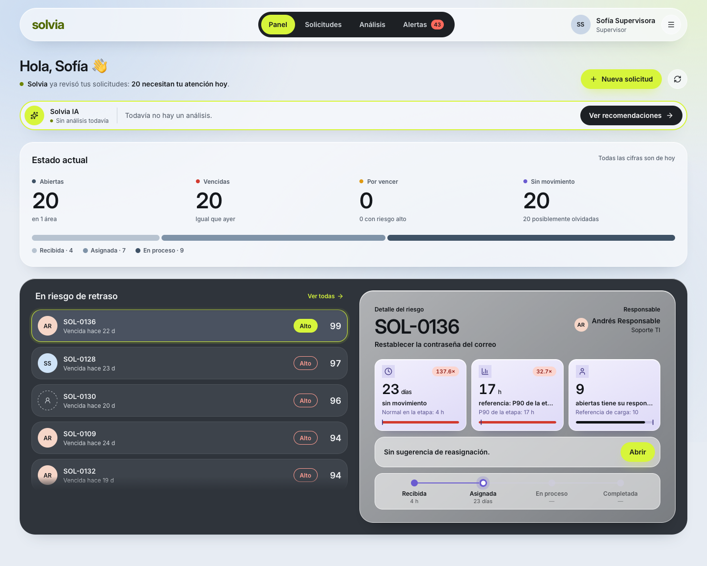
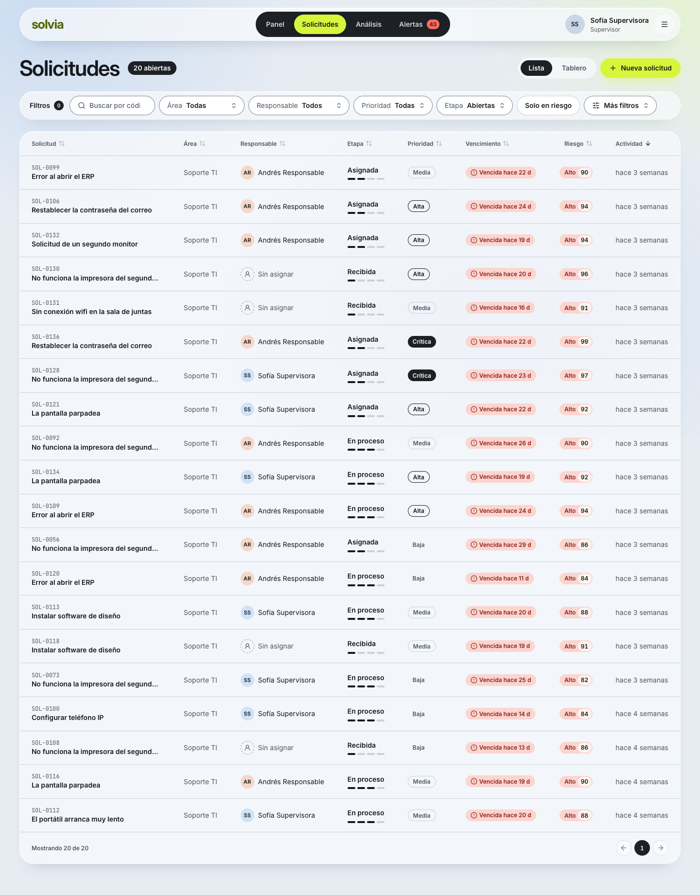
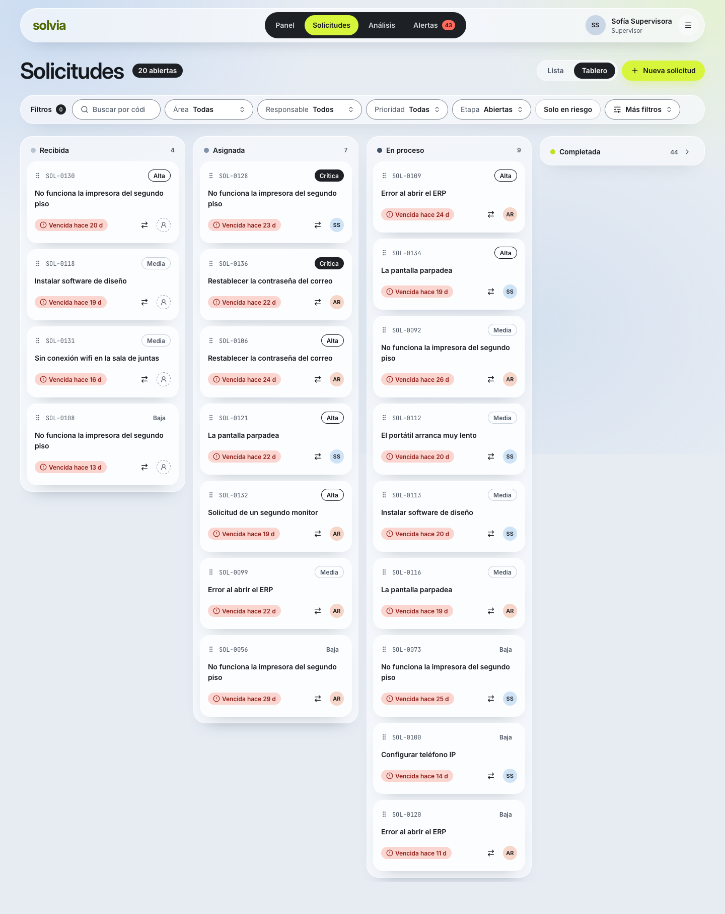
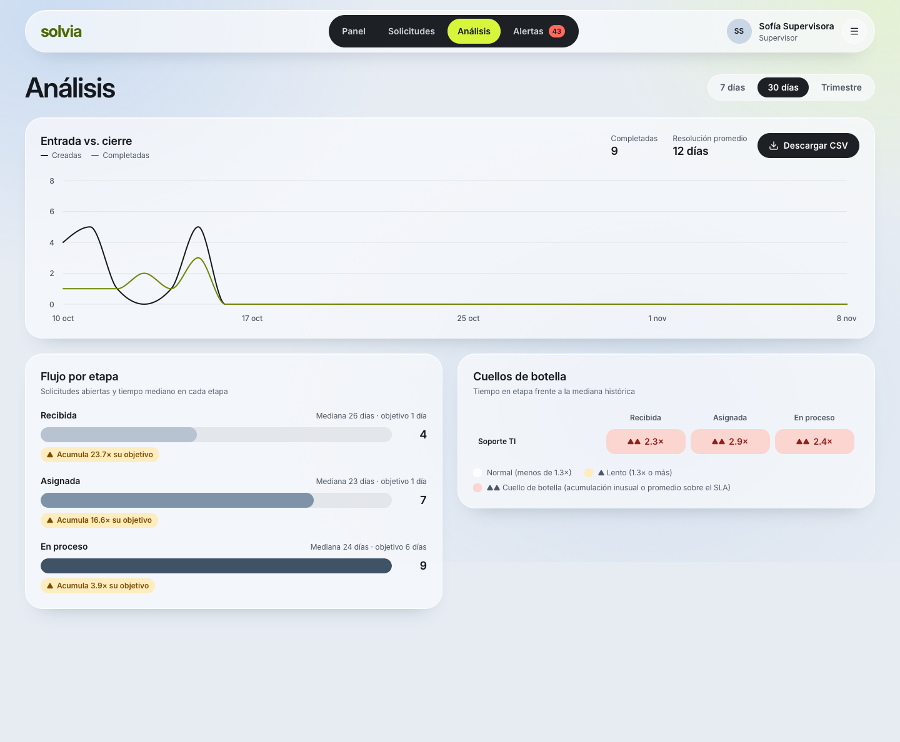
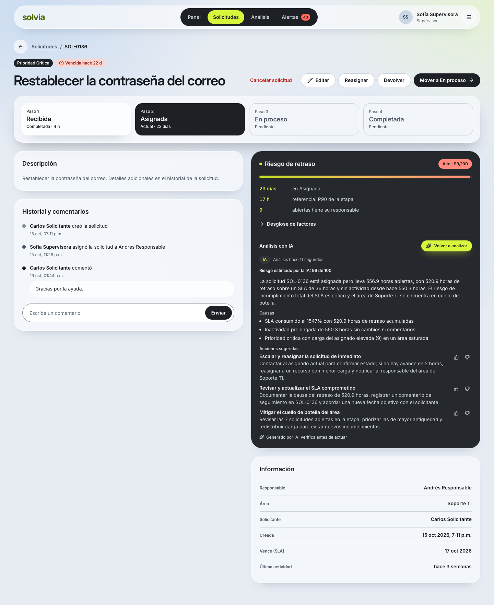
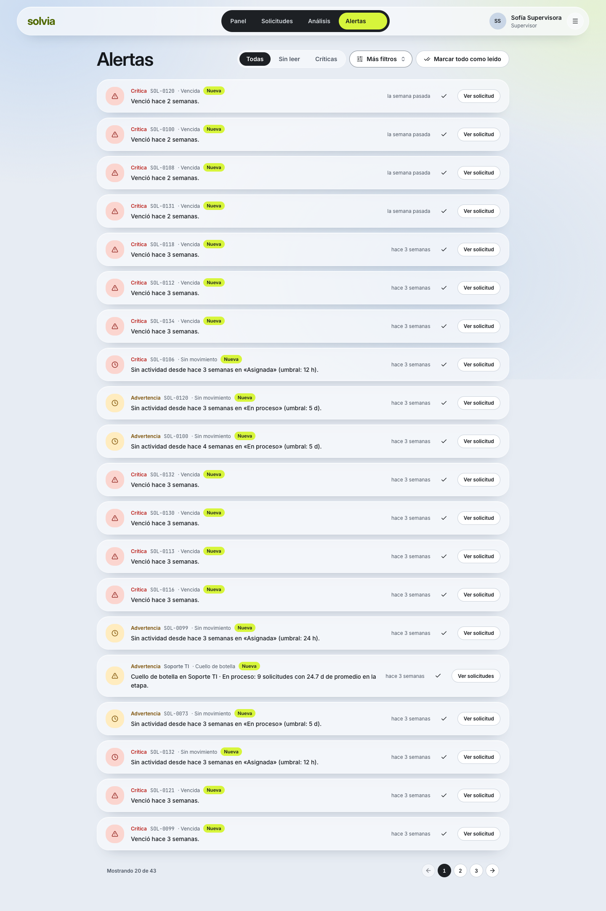
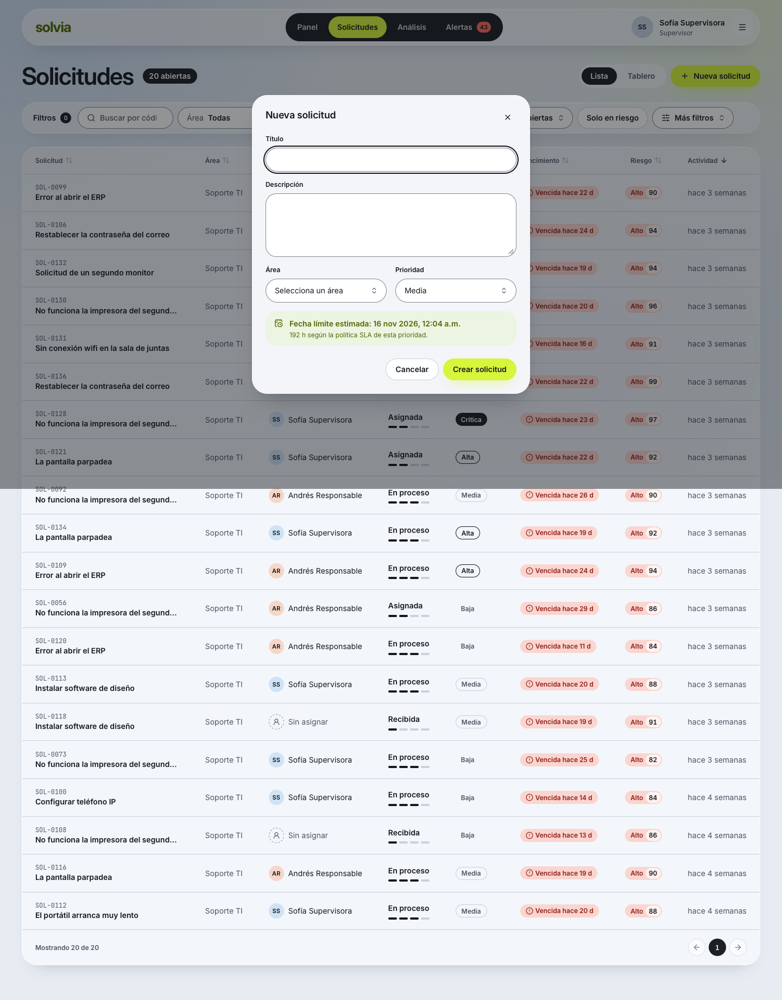
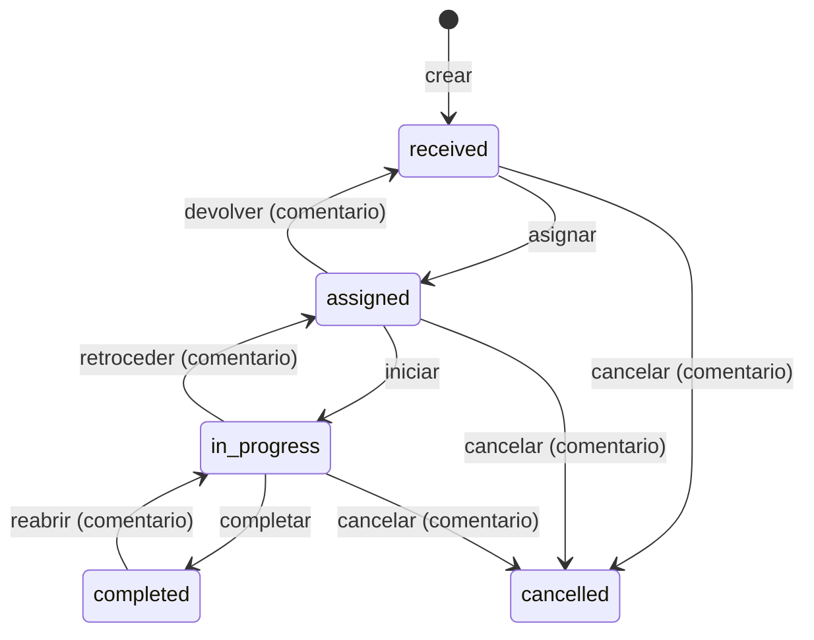

# Solvia

Aplicación de escritorio para la **gestión inteligente de solicitudes**, para Windows y macOS.

## ¿Qué es Solvia y qué soluciona?

En empresas, universidades y oficinas las solicitudes quedan sin seguimiento, tardan demasiado
en una etapa o se olvidan, y no se sabe dónde se generan los retrasos.

Solvia permite registrar, organizar y dar seguimiento a cada solicitud: con responsable, área,
fecha, prioridad y estado (_recibida → asignada → en proceso → completada_). Incluye un panel de
control, alertas automáticas por SLA, detección de cuellos de botella e inteligencia artificial
que detecta problemas antes de que se conviertan en atrasos.

## Descargar

| Sistema | Instalador |
| --- | --- |
| Windows | [Solvia_1.0.0_x64-setup.exe](https://github.com/LauraEscobar1/Solvia/releases/download/v1.0.1/Solvia_1.0.0_x64-setup.exe) |
| macOS (Apple Silicon e Intel) | [Solvia_1.0.0_universal.dmg](https://github.com/LauraEscobar1/Solvia/releases/download/v1.0.1/Solvia_1.0.0_universal.dmg) |

> Los instaladores no están firmados, así que el sistema muestra un aviso al abrirlos:
> - **Windows:** en el aviso de SmartScreen, pulsa **Más información → Ejecutar de todas formas**.
> - **macOS:** ve a **Configuración del sistema → Privacidad y seguridad** y pulsa **Abrir de todas formas**.

## Capturas

### Inicio de sesión

### Panel de control

### Lista de solicitudes

### Tablero

### Análisis

### Detalle de solicitud

### Alertas

### Nueva solicitud

## Inteligencia artificial

Solvia usa **DeepSeek** a través de su API compatible con OpenAI (`https://api.deepseek.com`),
con dos modelos: `deepseek-flash` para el análisis de cada solicitud y `deepseek-v4-pro` para el
análisis global y por área.

La IA calcula el riesgo de retraso de cada solicitud y explica sus causas, recomienda acciones,
resume el estado general e identifica dónde se acumulan los retrasos, y genera alertas cuando
detecta un riesgo alto.

## Flujo de estados

## Stack

| Parte | Tecnologías |
| --- | --- |
| App de escritorio | Tauri 2 (Rust) · React 19 · TypeScript · Vite · Tailwind CSS 4 · TanStack Query · Zustand · React Router · React Hook Form · Zod · dnd-kit · Recharts · i18next · Motion |
| Backend | Python 3.12 · FastAPI · Uvicorn · SQLAlchemy 2 (async, asyncpg) · Alembic · Pydantic 2 · APScheduler · PyJWT · argon2 (pwdlib) · structlog |
| Base de datos | PostgreSQL 16 |
| IA | DeepSeek (SDK de OpenAI) |
| Infraestructura | Docker · Railway · GitHub Actions · gitleaks |

## Despliegue

| Componente | Dónde corre |
| --- | --- |
| API | Railway, como contenedor Docker construido desde `backend/Dockerfile` |
| Base de datos | PostgreSQL de Railway |
| Instaladores | GitHub Actions los genera para Windows y macOS al publicar una etiqueta `v*` |
