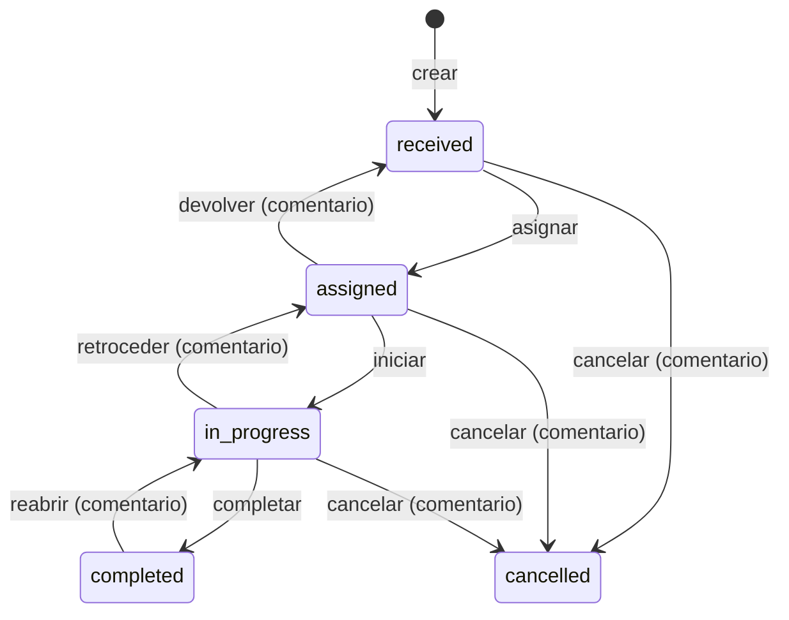

# Solvia

Aplicación de escritorio para la **gestión inteligente de solicitudes**. Cada solicitud
recorre los estados _recibida → asignada → en proceso → completada_, y una IA (DeepSeek)
detecta retrasos y cuellos de botella.

> **Estado: Fase 2.** Además de la autenticación, los roles y la administración de la Fase 1,
> la app gestiona solicitudes de punta a punta: flujo de estados, asignación, comentarios,
> historial, lista con filtros, tablero kanban y detalle. Las alertas y el análisis con IA
> llegan en las fases 3 y 4.

## Stack

| Parte | Tecnologías |
| --- | --- |
| `backend/` | Python 3.12 · FastAPI · SQLAlchemy 2 (async, asyncpg) · Alembic · Pydantic 2 · structlog · PyJWT · argon2 (pwdlib) |
| `desktop/` | Tauri 2 · React 19 · TypeScript · Vite · Tailwind CSS 4 · i18next · TanStack Query · Zustand · React Router · React Hook Form · Zod · dnd-kit |
| Infra | PostgreSQL 16 (Docker) · GitHub Actions · gitleaks |

## Requisitos

- [Docker Desktop](https://www.docker.com/products/docker-desktop/)
- [uv](https://docs.astral.sh/uv/) (`brew install uv`): instala Python 3.12 automáticamente
- Node.js 22 o superior (la versión de referencia está en `desktop/.nvmrc`)
- Rust, solo para ejecutar o empaquetar la app de escritorio: `brew install rustup && rustup default stable`
- En Linux, además, las [dependencias de Tauri](https://v2.tauri.app/start/prerequisites/) y `libdbus-1-dev`

> **macOS con Homebrew:** `rustup` no se enlaza en el `PATH`. Añade esta línea a tu `~/.zshrc`:
> `export PATH="/opt/homebrew/opt/rustup/bin:$PATH"`

## 1. Configuración inicial

```bash
cp .env.example .env
```

`.env` está en `.gitignore`: **nunca se versiona**. Ajusta allí los valores locales y, como
mínimo, define el administrador inicial:

```dotenv
SEED_ADMIN_EMAIL=admin@example.com
SEED_ADMIN_PASSWORD=<mínimo 12 caracteres>
# Usuarios de demostración (supervisor, responsables y solicitantes); necesaria para --demo
SEED_DEMO_PASSWORD=<mínimo 12 caracteres>
```

Si tu `.env` viene de la Fase 0, copia también las variables nuevas de `.env.example`
(`REFRESH_TOKEN_DAYS`, `LOGIN_RATE_LIMIT_*`, `SEED_*`) y cambia `JWT_SECRET`:
un secreto de menos de 32 caracteres hace que PyJWT muestre avisos.

### Activar DeepSeek (opcional)

En `.env`:

```dotenv
AI_PROVIDER=deepseek
DEEPSEEK_API_KEY=<tu clave>
```

Con `AI_PROVIDER=none` (valor por defecto) se usa un puntaje heurístico sin llamadas externas.
Si eliges `deepseek` sin clave, la API no arranca y muestra un error explícito.

## 2. Levantar el backend

### Opción A: todo en Docker

```bash
docker compose up -d --build                                # aplica las migraciones al arrancar
docker compose exec api python -m app.scripts.seed --demo   # admin, áreas, SLA y datos de demo
```

Sin `--demo` la semilla crea solo el admin, las áreas y la matriz SLA.

- Estado: <http://localhost:8000/api/v1/health>
- Documentación interactiva: <http://localhost:8000/docs> (desactivada en producción)

Para ver los logs: `docker compose logs -f api`. Para pararlo: `docker compose down`
(añade `-v` para borrar también los datos de PostgreSQL).

### Opción B: API local con recarga automática

```bash
docker compose up -d postgres          # solo la base de datos
cd backend
uv sync                                # crea .venv con Python 3.12
uv run alembic upgrade head
uv run python -m app.scripts.seed --demo
uv run uvicorn app.main:create_app --factory --reload
```

La API y la semilla leen el `.env` de la raíz del repositorio. La semilla es idempotente:
puedes ejecutarla las veces que quieras y solo crea lo que falta, sin sobrescribir
contraseñas ni políticas SLA editadas.

### Datos de demostración (`--demo`)

Con `--demo` (y `SEED_DEMO_PASSWORD` definida; no se permite en producción) se crean estos
usuarios, todos con la contraseña de `SEED_DEMO_PASSWORD`:

| Email | Rol | Área |
| --- | --- | --- |
| `supervisor@example.com` | supervisor (responsable del área) | Soporte TI |
| `responsable1@example.com` | assignee | Soporte TI |
| `responsable2@example.com` | assignee | Recursos Humanos |
| `responsable3@example.com` | assignee | Finanzas |
| `solicitante1@example.com` · `solicitante2@example.com` | requester | — |

Además se generan 60 solicitudes repartidas entre áreas, prioridades y estados, con historial
realista en el pasado (asignaciones, devoluciones, retrocesos, comentarios y cierres). Algunas
están vencidas y otras llevan días sin movimiento: esos datos alimentarán el panel (Fase 3) y
la IA (Fase 4). La generación es determinista y no se repite si ya existen.

### Probar el login con el admin semilla

```bash
curl -s -X POST http://localhost:8000/api/v1/auth/login \
  -H 'Content-Type: application/json' \
  -d '{"email": "<SEED_ADMIN_EMAIL>", "password": "<SEED_ADMIN_PASSWORD>"}'
```

La respuesta incluye `access_token` (30 min), `refresh_token` y el perfil del usuario.

## 3. Levantar la app de escritorio

```bash
cd desktop
npm install
npm run tauri dev      # ventana nativa (necesita Rust)
# o bien
npm run dev            # solo el frontend en http://localhost:1420
```

- Inicia sesión con el admin semilla. Con **Recordarme**, el refresh token se guarda en el
  llavero del sistema (Llavero de macOS, Administrador de credenciales de Windows o Secret
  Service en Linux) y la sesión se restaura al abrir la app. En `npm run dev` (navegador) no
  hay llavero y la sesión vive solo en memoria.
- Al iniciar sesión se aplican el tema y el idioma del perfil; los cambios en
  **Configuración** se guardan en el perfil.
- Los usuarios creados por un admin reciben una contraseña temporal y deben cambiarla al entrar.
- La URL de la API (por defecto `http://localhost:8000`) se cambia desde **Configuración**.

Para generar el instalador: `npm run tauri build`.

## Roles y permisos

**Administración**

| Rol | Puede |
| --- | --- |
| `admin` | Todo: áreas, usuarios y políticas SLA |
| `supervisor` | Ver los usuarios de su área |
| `assignee` · `requester` | Ver y editar su propio perfil |

Reglas adicionales: un admin no puede desactivarse a sí mismo, siempre queda al menos un admin
activo, y desactivar a un usuario cierra sus sesiones al instante.

**Solicitudes**

| Rol | Ve | Puede |
| --- | --- | --- |
| `requester` | Las que creó | Crear, comentar y editar título y descripción mientras está recibida |
| `assignee` | Las asignadas a él, las de su área y las que creó | Crear, comentar y avanzar o devolver las suyas |
| `supervisor` | Las de su área y las que creó | Todo lo anterior en su área, más asignar, reasignar, cancelar, reabrir y editar prioridad y fecha límite |
| `admin` | Todas | Todo; puede asignar fuera del área y queda registrado |

Las reglas viven en `services/request_policy.py` y se prueban aparte.

## Flujo de estados



- La tabla de transiciones está en un solo lugar: `services/request_workflow.py`. Cualquier
  otra transición devuelve `409 request.invalid_transition` con `{from, to}`.
- Cada cambio actualiza la solicitud, crea su evento (con valores anteriores y nuevos en
  `details`) y actualiza `last_activity_at` en una sola transacción.
- Concurrencia optimista: cada cambio envía la `version` conocida; si no coincide, la API
  responde `409 request.version_conflict` y la app recarga conservando lo escrito.
- `due_at` = recepción + suma de las horas máximas de las tres etapas para su prioridad; se
  recalcula si cambia la prioridad. Una solicitud es "por vencer" con más del 75 % del plazo
  consumido y "sin movimiento" si su inactividad supera el umbral SLA de su etapa.

## API (`/api/v1`)

| Recurso | Endpoints |
| --- | --- |
| Auth | `POST /auth/login` · `POST /auth/refresh` · `POST /auth/logout` · `GET /auth/me` · `PATCH /auth/me` |
| Áreas | `GET /areas` · `POST /areas` · `GET /areas/{id}` · `PATCH /areas/{id}` · `POST /areas/{id}/deactivate` · `POST /areas/{id}/activate` |
| Usuarios | `GET /users` · `POST /users` · `GET /users/{id}` · `PATCH /users/{id}` · `POST /users/{id}/deactivate` · `POST /users/{id}/activate` |
| SLA | `GET /sla-policies` · `PUT /sla-policies` |
| Solicitudes | `GET /requests` · `GET /requests/board` · `GET /requests/due-estimates` · `POST /requests` · `GET /requests/{id}` · `PATCH /requests/{id}` · `POST /requests/{id}/transition` · `POST /requests/{id}/assign` · `POST /requests/{id}/comments` · `GET /requests/{id}/events` |
| Estado | `GET /health` |

Las listas se paginan con `?page=1&size=20&q=texto` y responden `{items, total, page, size}`
(`size` máximo 100). `GET /requests` admite además `status` y `priority` repetibles,
`area_id`, `assignee_id`, `requester_id`, `overdue=true`, `received_from`, `received_to` y
`sort` (por ejemplo `-due_at`), y siempre aplica el alcance del rol.

**Sesiones:** el access token (JWT de 30 minutos con `sub`, `role` y `area_id`) vive solo en
memoria en el desktop. El refresh token es opaco, se guarda como hash SHA-256, rota en cada uso
y se revoca al cerrar sesión; si se reutiliza uno ya rotado, se revocan todas las sesiones del
usuario. El login admite 5 intentos fallidos por minuto por email+IP y nunca revela si el email
existe.

## Probar el flujo completo con distintos roles

Con la API levantada y la semilla ejecutada con `--demo`, abre la app (`npm run tauri dev`) y
usa, por ejemplo, dos ventanas o cierra sesión entre pasos:

1. **Solicitante** (`solicitante1@example.com`): en **Solicitudes**, pulsa **Nueva solicitud**,
   elige *Soporte TI* y prioridad *Alta*; antes de guardar verás la fecha límite estimada.
   Solo ves tus solicitudes; puedes editar título y descripción mientras esté recibida.
2. **Supervisor** (`supervisor@example.com`): en el tablero, arrastra la nueva tarjeta de
   *Recibida* a *Asignada*; se abrirá el diálogo para elegir responsable (solo de su área).
3. **Responsable** (`responsable1@example.com`): abre la solicitud, pulsa **Iniciar** y luego
   **Completar**. Prueba **Devolver** en otra asignada: exige un comentario y la deja sin
   responsable en la bandeja del supervisor.
4. **Supervisor**: abre la solicitud completada y pulsa **Reabrir** (pide comentario). El
   responsable no ve ese botón.
5. **Conflicto de versión**: abre la misma solicitud como supervisor en dos ventanas, cambia la
   prioridad en una y guarda el título en la otra: verás el aviso de que fue modificada por
   otra persona, la solicitud se recargará y tu título seguirá escrito.
6. **Admin** (`SEED_ADMIN_EMAIL`): ve todas las solicitudes y puede asignar a alguien de otra
   área; el historial lo marca como asignación fuera del área.

En la lista, prueba los filtros combinados (se guardan en la URL), el orden por columna y los
indicadores: rojo vencida, ámbar por vencer y reloj sin movimiento.

## Pruebas y calidad

Las pruebas del backend usan un PostgreSQL real, separado del de desarrollo:

```bash
docker compose --profile test up -d postgres-test   # puerto 5433, datos en memoria

# Backend
cd backend
uv run ruff check . && uv run ruff format --check .
uv run mypy
uv run pytest            # aplica las migraciones reales y prueba auth, permisos, flujo…

# Desktop
cd desktop
npm run lint
npm run typecheck
npm test
npm run build
```

Si `postgres-test` no está levantado, las pruebas de base de datos se omiten (en CI fallan,
porque se define `REQUIRE_TEST_DB=1`). Para usar otra base, define `TEST_DATABASE_URL`.

GitHub Actions (`.github/workflows/ci.yml`) ejecuta lo mismo en cada push o PR a `main`
(con un servicio PostgreSQL 16), compila el plugin nativo de Tauri con `clippy` y escanea el
historial con **gitleaks** en busca de secretos.

## Migraciones

```bash
cd backend
uv run alembic revision --autogenerate -m "crear tabla x"
uv run alembic upgrade head
uv run alembic check      # verifica que modelos y migraciones coinciden
```

Los modelos nuevos deben importarse en `app/models/__init__.py` para que Alembic los detecte.
Los enums de Postgres, la secuencia `request_code_seq` y la función `next_request_code()`
(códigos `SOL-0001`) se gestionan a mano en la migración `0001`. Nunca se edita una migración
ya aplicada: cada cambio de esquema va en una nueva (la `0002` añade `version`, `details` e
índices para los filtros de solicitudes).

## Estructura

```
backend/
  app/
    api/v1/        rutas HTTP: auth, areas, users, sla_policies, requests, health
    core/          configuración, logging, errores, seguridad (JWT, argon2), rate limit
    db/            engine, sesión, Base (naming convention, mixins UUID/timestamps)
    models/        areas, users, requests, request_events, sla_policies, alerts,
                   ai_insights, refresh_tokens
    schemas/       modelos Pydantic de entrada/salida y paginación
    repositories/  acceso a datos (nunca hacen commit)
    services/      reglas de negocio y transacciones; request_workflow (máquina de estados),
                   request_policy (permisos por rol) y sla (fechas límite e indicadores)
    ai/            AIProvider + NullProvider + DeepSeekProvider + factory
    scripts/       seed (datos semilla) y demo_data (60 solicitudes con historial)
    jobs/          tareas en segundo plano (fases futuras)
  alembic/         migraciones (async)
  tests/           pruebas unitarias y tests/db contra PostgreSQL
desktop/
  src/
    components/    layout, guards de rutas, UI compartida, selectores
    pages/         login, panel, solicitudes (lista, tablero y detalle), administración,
                   configuración
    lib/           cliente de API con refresco automático, sesión, llavero, formato
    stores/        Zustand (sesión en memoria, tema, configuración)
    locales/       traducciones es/en por módulo
  src-tauri/       contenedor nativo (Rust) con el plugin secure-store
```

## Errores de la API

La API nunca devuelve textos: responde con códigos estables que el frontend traduce.

```json
{ "error": { "code": "auth.invalid_credentials", "params": {} } }
```

Las traducciones están en `desktop/src/locales/{es,en}/errors.json`. Una prueba del backend
falla si algún código no tiene traducción.

## Seguridad

- Los secretos (`JWT_SECRET`, `DEEPSEEK_API_KEY`, `DATABASE_URL`, `SEED_*_PASSWORD`) son
  `SecretStr` y se enmascaran en logs y errores.
- En producción la API no arranca si `JWT_SECRET` tiene el valor de ejemplo o menos de 32 caracteres.
- Contraseñas con argon2; refresh tokens guardados solo como hash.
- Los logs pasan por un filtro que oculta claves sensibles, tokens `Bearer`, claves `sk-…`
  y contraseñas en URLs.
- La imagen Docker se ejecuta con un usuario sin privilegios y los puertos solo escuchan en `127.0.0.1`.
